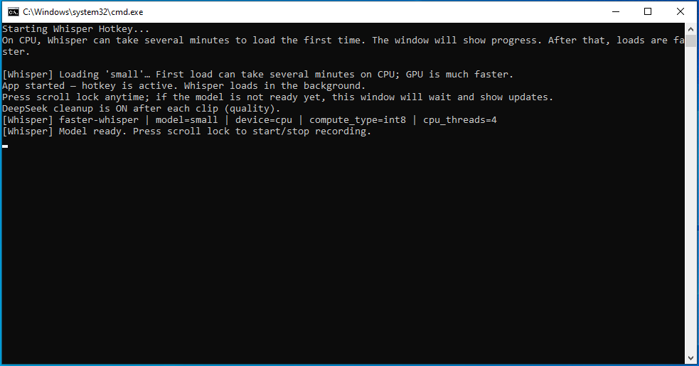
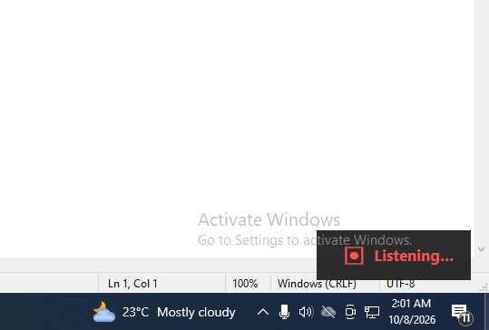
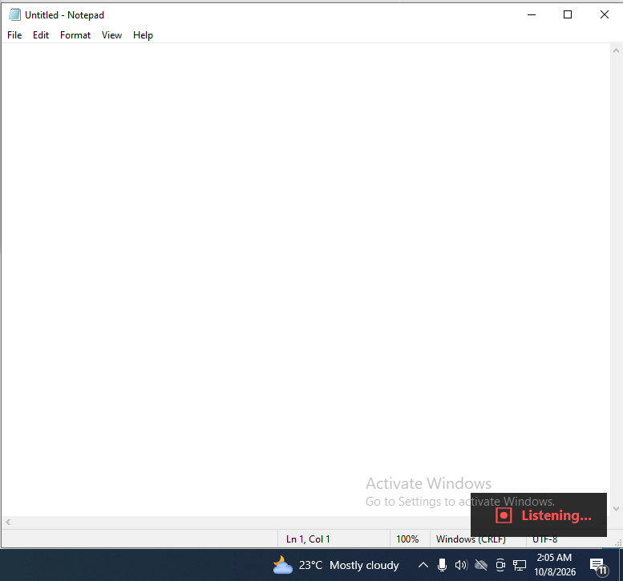
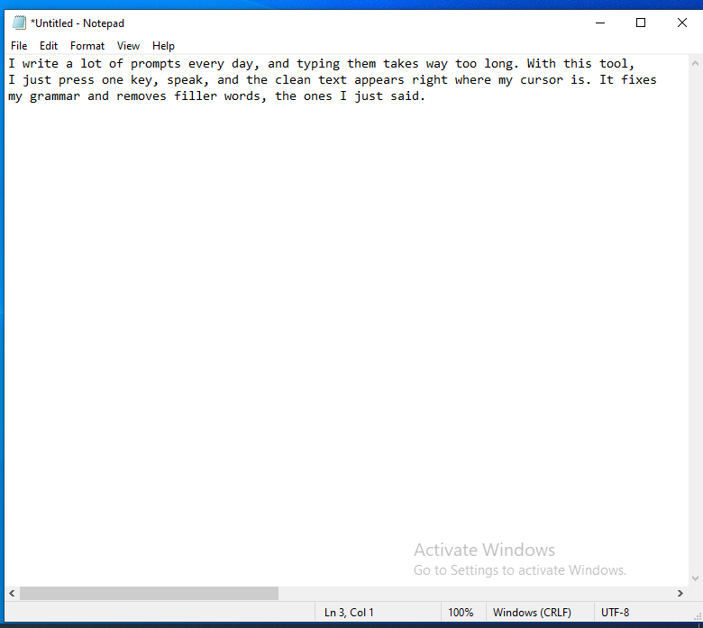
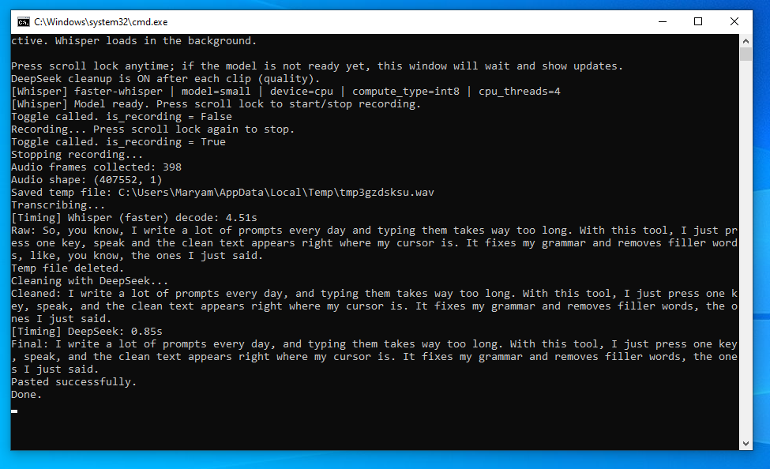

# Whisper Hotkey

<!-- Screenshot width convention for this file: 560px for the small overlay/paste shots (01-04), 720px for the console shot (05). Change the width="..." values below to resize. -->

Press a hotkey, speak, press it again. Your words get transcribed and pasted wherever your cursor is.

## Why I built it

I write a lot of prompts, at work and in my own projects. I tried Wispr Flow (it's paid, I used the free trial for a week), and it made my life noticeably easier. I wasn't ready to pay for it, and after using it for a week I understood the logic behind how it worked, so I built a small version for myself.

To be clear: this isn't a copy of Whisper, and it isn't a clone of Wispr Flow. It uses OpenAI's open-source Whisper model locally as the speech-to-text engine, with a DeepSeek cleanup pass on top.

## Walkthrough

<p align="center">
  
  <br>
  <em>Startup: the model loads in the background while the hotkey is already active.</em>
</p>

<p align="center">
  
  <br>
  <em>Listening: a small overlay in the corner while recording.</em>
</p>

<p align="center">
  
  <br>
  <em>Recording: talking into whatever app currently has focus.</em>
</p>

<p align="center">
  
  <br>
  <em>Done: the cleaned-up text lands right where the cursor was.</em>
</p>

<p align="center">
  
  <br>
  <em>Console: timestamped steps for one dictation, start to finish.</em>
</p>

## How it works

```
Hotkey press ──► record audio ──► Whisper (local) ──► raw transcript
                                                              │
                                                    DeepSeek cleanup pass
                                          (grammar, filler, and homophones,
                                             not a chat response)
                                                              │
                                                              ▼
                                        clipboard + simulated Ctrl+V
                                        → pasted at the active cursor
```

The whole thing is two Python files. No server, no account, no stored recordings: audio is written to a temp `.wav`, transcribed, then deleted.

## Tech stack

Python · `openai-whisper` / `faster-whisper` (local, free) · DeepSeek API (cleanup pass, cheap and fast) · `keyboard` for the global hotkey · `pywin32` for clipboard + paste simulation.

## Run it locally

Windows only.

```bat
git clone https://github.com/Maryam-Nisar-Ahmad/whisper-hotkey.git
cd whisper-hotkey
install.bat
copy .env.example .env
:: add your DEEPSEEK_API_KEY
run.bat
```

Press your hotkey (default `r`; set `WHISPER_HOTKEY` in `.env` to something less likely to collide with normal typing, like `scroll lock`) to start recording, press it again to stop. First model load can take a few minutes on CPU. The console shows progress so it's clear it isn't frozen.

## Hardest part / what I learned

The genuinely hard part was pasting into whatever window currently has focus. There's no clean cross-app API for that on Windows, so it's clipboard plus a simulated Ctrl+V. Everything else was fairly easy by comparison.

A few things I only got right after getting them wrong first, visible in the commit history:
- The cleanup prompt has to explicitly say "this is dictation, not a chat: never summarize it, never answer it, never shorten it." Without that, DeepSeek would sometimes try to respond to what I'd said instead of just cleaning it up.
- A lock around the whole transcribe-and-paste step, so a second recording can't finish and paste out of order with the one before it.
- The model loads on a background thread at startup, so the hotkey is already listening before the (sometimes multi-minute, on CPU) model load finishes.

## Known limits

- Windows only: the clipboard/paste mechanism is Windows-specific.
- No tests beyond a small manual/automated check for the debounce logic and hotkey registration.
- Whatever app currently has focus when you stop recording is where the text gets pasted. There's no target-window selection.
- Each transcript is sent to the DeepSeek API for the cleanup pass. Set `SKIP_DEEPSEEK=1` in `.env` to keep everything local (you get the raw Whisper transcript instead, un-cleaned).

## License

MIT (see [LICENSE](LICENSE)).
